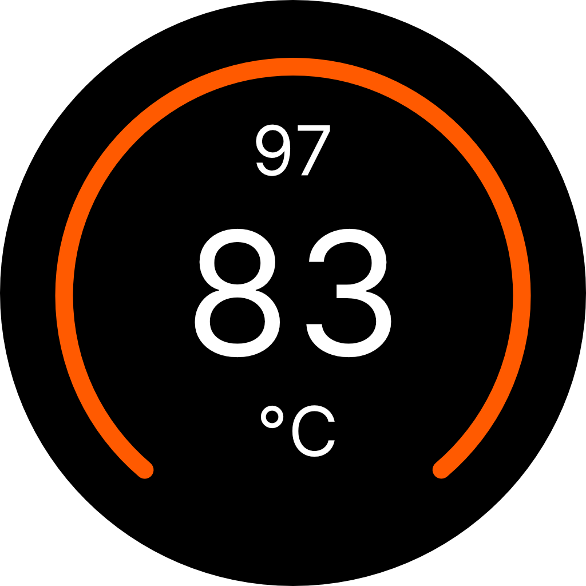

# StaggAssistant 🦢☕️

A Home Assistant integration for the **Fellow Stagg EKG Pro** kettle.
This integration communicates directly with the kettle's internal interface over local HTTP.

 

## ✨ Features

* **Dual Firmware Architecture (v1.2.26+ & Legacy):** Automatically leverages the modern `/temp` JSON endpoint on firmware 1.2.26+ while seamlessly falling back to `/cli` commands on older firmware. Robustly handles lifted kettle readings (`NaN`, `-nan`, null).
* **Hardware & Fire Safety Interlocks:**
  * **Dry-Boil Guard:** Heating is strictly blocked if low water (`no_water` / `S_NoWater`) is detected.
  * **Undocked Kettle Protection:** Heating cannot be activated when the kettle is removed from the base (`is_docked == False`).
  * **Safe Temperature Adjustments:** Adjusting the target temperature slider will not accidentally turn on the heater while the kettle is off.
  * **Strict Command Allowlist:** All CLI commands are verified against a regex allowlist with strict parameter bounds, blocking raw GPIO commands (`heaton`, `warmduty`), diagnostics (`htest`), or wipe commands (`clrsettings`).
  * **Guaranteed Dial Release:** Timer button simulation wraps execution in `try...finally:` guaranteeing the release command (`2u`) is always sent.
* **Persistent Settings Storage:** Persists kettle settings (hold duration, chime, altitude, schedule, clock mode) using Home Assistant's native storage (`Store`) so settings survive Home Assistant restarts even when firmware restricts Wi-Fi reading.
* **Configurable Options Flow:** Configure polling rate (5–120s) and selectively enable extended settings & sensors anytime via the Home Assistant UI.
* **Full Multilingual Support:** Native English and German (Deutsch) translations for setup, configuration options, entity names, and state selectors.

---

## ⚡️ Important Notice for Firmware 1.2.26+

Starting with **Firmware 1.2.26**, Fellow updated the ESP32 firmware to silence textual output from the internal `/cli` endpoint (returning only an empty HTML form `<form action="cli"...>`) and introduced a modern `GET /temp` JSON endpoint.

StaggAssistant automatically detects your firmware version:
* On **v1.2.26+**, live temperature and state are fetched via `/temp`.
* On **older firmware**, it seamlessly falls back to `/cli?cmd=state`.

### Why are some entities hidden by default?
On firmware 1.2.26+, reading device settings (such as current hold time, chime volume, or schedule) over Wi-Fi is no longer supported by the kettle's firmware. To prevent your Home Assistant dashboard from being cluttered with **"Unknown"** entities, extended settings and sensors are disabled by default. You can enable them anytime under **Integration Options** (see below).

---

## ⚙️ Configuration & Options

After adding the integration, click **Configure** on the StaggAssistant card under **Settings > Devices & Services**:

* **Update Interval (Seconds):** Choose how often Home Assistant polls the kettle (5 to 120 seconds, default: 15s).
* **Enable extended settings & sensors (Advanced):**
  * *Disabled (Default):* Exposes the core entities (Climate controller, Current Temperature, Target Temperature, Docked, Heating Active, Hold Active, Low Water Warning, Buttons).
  * *Enabled:* Unlocks extended controls (Pre-Boil switch, Hold Time slider, Altitude setting, Chime volume, Clock style, Schedule controls, Boil temperature sensor). On firmware 1.2.26+, these rely on persistent local caching (`Store`) and altitude estimates.

---

## 📋 Available Entities & Controls

The integration exposes up to **27 entities** to fully monitor and manage your kettle from Home Assistant:

| Platform | Entity (EN) | Entity (DE) | Description |
| :--- | :--- | :--- | :--- |
| **`climate`** | Kettle | Wasserkocher | Main thermostat UI to turn on/off and set temperature |
| **`sensor`** | Current Temperature | Aktuelle Temperatur | Current water temperature (with statistics history) |
| **`sensor`** | Target Temperature | Zieltemperatur | Target set temperature |
| **`sensor`** | Boil Temperature | Siedetemperatur | Altitude-adjusted boiling temperature |
| **`sensor`** | State Mode | Betriebszustand | Human-readable kettle state (Off, Heat, Hold, etc.) |
| **`sensor`** | Clock Time | Uhrzeit | Current kettle clock time |
| **`sensor`** | Schedule Time | Zeitplan-Uhrzeit | Scheduled wake-up time (HH:MM) |
| **`sensor`** | Schedule Temperature | Zeitplan-Temperatur | Scheduled target temperature |
| **`binary_sensor`** | Docked | Auf Basis | Detects if the kettle is resting on the base |
| **`binary_sensor`** | Low Water Warning | Niedrigwasser-Warnung | Dry-boil / low-water alert (`nw` flag / `S_NoWater`) |
| **`binary_sensor`** | Target Temperature Reached | Zieltemperatur erreicht | Signals when water has reached the desired temperature |
| **`binary_sensor`** | Pre-Boil Active | Pre-Boil aktiv | Signals when pre-boil heating is actively running |
| **`binary_sensor`** | Heating Active | Heizen aktiv | Indicates heating element operation |
| **`binary_sensor`** | Hold Active | Warmhalten aktiv | Indicates keep-warm mode is actively maintaining temperature |
| **`switch`** | Pre-Boil | Pre-Boil | Toggle the pre-boil feature on/off |
| **`number`** | Hold Time Duration | Warmhaltezeit | Set hold time duration in minutes (0–60) |
| **`number`** | Altitude Setting | Höheneinstellung | Set altitude for boil calibration (0–3000 m) |
| **`number`** | Chime Volume | Signalton-Lautstärke | Set chime volume (0–10) |
| **`number`** | Schedule Temperature | Zeitplan-Temperatur | Set scheduled target temperature |
| **`select`** | Clock Style | Uhrenstil | Choose off, digital, or analog clock display |
| **`select`** | Language Selection | Sprachauswahl | Supports all 7 internal languages (EN, FR, ES, ZH-Hans, ZH-Hant, KO, JA) |
| **`select`** | Temperature Units | Temperatureinheit | Switch display units between Celsius and Fahrenheit |
| **`select`** | Schedule Mode | Zeitplan-Modus | Choose off, once, or repeat schedule |
| **`button`** | Press Main Button | Haupttaster drücken | Simulate pressing the main dial button (e.g. toggles heat or confirms) |
| **`button`** | Press Menu Button | Menütaste drücken | Simulate pressing the back/menu button |
| **`button`** | Rotate Dial Left | Drehknopf links drehen | Rotate the dial counter-clockwise |
| **`button`** | Rotate Dial Right | Drehknopf rechts drehen | Rotate the dial clockwise |
| **`button`** | Start Timer | Brühtimer starten | Long press dial button to start brew timer |
| **`button`** | Sync Time | Uhrzeit synchronisieren | Sync current Home Assistant system time to the kettle |
| **`button`** | Reload Data | Daten neu laden | Force a manual data refresh from the kettle |

---

## 🚀 Installation

### Option 1: HACS (Recommended)

1. Open **HACS** in Home Assistant.
2. Go to **Integrations** > Top right menu (**⋮**) > **Custom repositories**.
3. Add the URL of this repository: `https://github.com/fabiankirchen/staggassistant`
4. Category: **Integration**.
5. Click **Add**, then search for **StaggAssistant** in the list and install it.
6. Restart Home Assistant.

### Option 2: Manual

1. Download the latest release from the [Releases section](https://github.com/fabiankirchen/staggassistant/releases).
2. Unzip the file.
3. Copy the `custom_components/staggassistant` folder into your Home Assistant `/config/custom_components/` directory (so that the path is `/config/custom_components/staggassistant`).
4. Restart Home Assistant.

### 🧪 Bleeding-Edge Beta Channel (Optional)

If you would like to test experimental features and rapid automated updates before they are reviewed and merged into this stable repository, you can add the development fork as an additional custom repository in HACS:

* **Repository URL:** `https://github.com/fabiagent/staggassistant`
* **Category:** `Integration`
*(Note: Releases on the development fork are autonomous builds intended for early testing).*

---

## ⚙️ Initial Setup

1. In Home Assistant, go to **Settings** > **Devices & Services**.
2. Click **Add Integration** in the bottom right corner.
3. Search for **StaggAssistant**.
4. Enter the **IP address** of your kettle and choose your preferred update interval.
5. Click **Submit**.

---

## 🤖 AI Co-Maintenance & Development

This repository is maintained by [@fabiankirchen](https://github.com/fabiankirchen) in collaboration with **`fabiagent`** (autonomous coding agent).
* **Stable Upstream (Recommended):** [`fabiankirchen/staggassistant`](https://github.com/fabiankirchen/staggassistant) — **100% human-verified:** Every release and code change in this main repository is thoroughly tested on real physical kettle hardware by Fabian Kirchen before being merged and published.
* **Development Fork (Bleeding-Edge):** [`fabiagent/staggassistant`](https://github.com/fabiagent/staggassistant) — Rapid autonomous iterations, automated test builds, and pre-releases for early testers before human hardware verification.

All code changes are continuously backed by automated unit test suites covering Python 3.11, 3.12, 3.13, Hassfest, and HACS validation.

---

## ❤️ Credits

* Repository owner: **[@fabiankirchen](https://github.com/fabiankirchen)**
* Huge thanks to **[@tomtastic](https://github.com/tomtastic)** for his reverse-engineering and comprehensive [Firmware 1.2.26 analysis](https://github.com/tomtastic/homebridge-stagg-ekg-pro/wiki/1.2.26) of the Stagg EKG Pro ESP32 image.
* Big thanks to the repositories **[stagg-ekg-pro](https://github.com/tomtastic/stagg-ekg-pro)** & **[homebridge-kettle](https://github.com/Willmac16/homebridge-kettle/tree/ekg-pro-cli)** through which direct kettle CLI communication was discovered.
* A huge shout-out and massive thanks to **[@miguelcaravantes](https://github.com/miguelcaravantes)** for contributing the multi-platform overhaul, unlocking the scheduling features, dial buttons, and lifting this integration to a whole new level!

---

## 📄 License

MIT License. See [LICENSE](LICENSE) file for more details.  
This project is an independent community project and is not affiliated with Fellow Industries, Inc.
